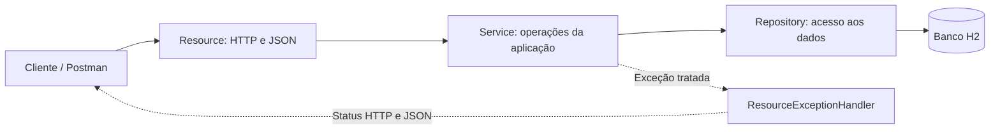
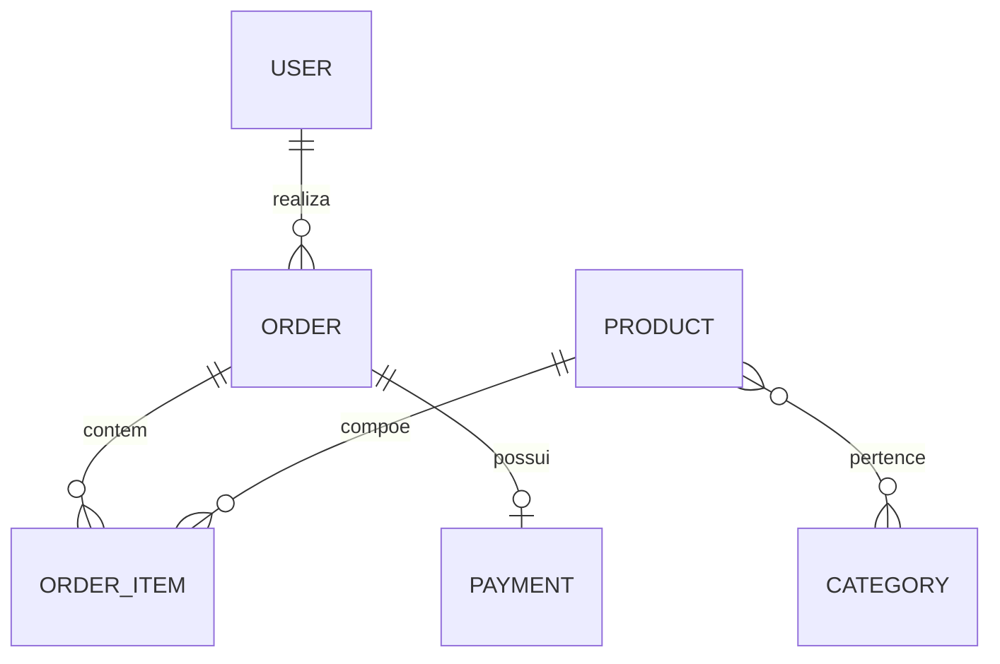

# Course — API de usuários e pedidos

Backend desenvolvido em Java com Spring Boot para estudar a construção de uma API REST e a persistência de um domínio de vendas. A aplicação relaciona usuários, produtos, categorias, pedidos, itens e pagamentos.

O projeto demonstra organização em camadas, mapeamento de relacionamentos com JPA, operações de banco com Spring Data e tratamento de exceções HTTP. Atualmente, oferece CRUD de usuários e consultas de produtos, categorias e pedidos, com dados de exemplo carregados na inicialização.

## Objetivos de aprendizado

- Separar o recebimento de requisições, a lógica da aplicação e o acesso ao banco.
- Modelar entidades e relacionamentos de um sistema de vendas.
- Trabalhar com chaves primárias, chaves estrangeiras e chave composta.
- Utilizar métodos HTTP e códigos de resposta para representar o resultado das operações.
- Transformar exceções em respostas JSON compreensíveis.
- Executar testes de integração com um banco em memória.

## Tecnologias

| Tecnologia | Papel no projeto |
| --- | --- |
| Java 25 | Linguagem e versão exigida pelo build |
| Spring Boot 4.1.1 | Configuração e inicialização da aplicação |
| Spring Web MVC | Endpoints REST e respostas HTTP |
| Spring Data JPA | Repositórios para acesso aos dados |
| Jakarta Persistence / Hibernate | Mapeamento entre objetos Java e tabelas |
| H2 | Banco em memória utilizado no perfil `test` |
| Gradle Wrapper 9.7.1 | Compilação, testes e empacotamento |
| JUnit Jupiter e Spring Boot Test | Testes automatizados |

O driver PostgreSQL está nas dependências, mas ainda não existe um perfil de conexão com esse banco no repositório.

## Arquitetura e organização

```text
src/main/java/com/educandoweb/course/
├── CourseApplication.java       # Ponto de entrada
├── config/                      # Carga inicial de dados
├── entities/                    # Entidades persistidas
│   ├── enums/                   # Estados do pedido
│   └── pk/                      # Chave composta dos itens
├── repositories/                # Interfaces Spring Data JPA
├── services/                    # Operações da aplicação
│   └── exceptions/              # Exceções personalizadas
└── resources/                   # Controllers REST
    └── exceptions/              # Handler e formato dos erros

src/main/resources/              # Configurações e perfis
src/test/java/                   # Testes automatizados
```

O caminho de uma requisição segue esta organização:



Os controllers recebem os parâmetros e montam as respostas. Os serviços coordenam as operações. Os repositórios estendem `JpaRepository`, que disponibiliza métodos como `findAll`, `findById`, `save` e `deleteById`. O Spring fornece essas dependências por injeção, usando `@Autowired` no código atual.

## Modelo de domínio



| Entidade | Responsabilidade |
| --- | --- |
| `User` | Dados do cliente e associação com seus pedidos |
| `Product` | Nome, preço, referência de imagem e categorias |
| `Category` | Agrupamento de produtos |
| `Order` | Cliente, momento, status, itens e pagamento |
| `OrderItem` | Produto, quantidade e preço registrado no item |
| `Payment` | Momento do pagamento e vínculo com o pedido |

### Relacionamentos e cálculos

- **Usuário e pedidos:** um usuário pode ter vários pedidos. A coluna `client_id` em `tb_order` referencia o usuário.
- **Produtos e categorias:** a relação muitos para muitos utiliza a tabela intermediária `tb_product_category`.
- **Itens:** `OrderItemPK` combina pedido e produto em uma chave composta, incorporada com `@EmbeddedId`. A quantidade permite representar várias unidades do mesmo produto no item.
- **Pagamento:** `@MapsId` faz o pagamento compartilhar a identificação do pedido. O `cascade = CascadeType.ALL` em `Order.payment` propaga operações para o pagamento associado.
- **Subtotal:** calculado por `price × quantity` em `OrderItem.getSubtotal()`.
- **Total do pedido:** soma dos subtotais, calculada em `Order.getTotal()`.

O item armazena seu próprio preço; o cálculo usa esse valor, em vez de consultar o preço atual do produto. Os totais são calculados pelos getters, sem campos próprios persistidos para esses resultados.

Algumas associações utilizam `@JsonIgnore` para evitar referências circulares no JSON, como pedido → cliente → pedidos.

### Estados do pedido

`OrderStatus` define códigos explícitos, armazenados como inteiro na entidade:

| Código | Estado |
| --- | --- |
| 1 | `WAITING_PAYMENT` |
| 2 | `PAID` |
| 3 | `SHIPPED` |
| 4 | `DELIVERED` |
| 5 | `CANCELED` |

A enumeração representa os estados disponíveis; ainda não há endpoints para alterar o status nem regras de transição entre eles.

## Como executar

É necessário ter o **JDK 25** instalado e disponível para o Gradle. O Wrapper incluído no repositório dispensa instalar o Gradle separadamente. A primeira execução pode baixar a distribuição e as dependências.

Na raiz do projeto, pelo PowerShell:

```powershell
.\gradlew.bat bootRun
```

Em Linux ou macOS:

```bash
./gradlew bootRun
```

A API fica disponível em `http://localhost:8080`. Para encerrar, use `Ctrl+C` no terminal.

### Perfil de teste e dados iniciais

O arquivo `application.properties` ativa o perfil `test`. As configurações do banco ficam em `application-test.properties`.

`TesteConfig` combina `@Configuration`, `@Profile("test")` e `CommandLineRunner` para executar a carga após a inicialização da aplicação. A configuração insere:

- 2 usuários;
- 3 categorias;
- 5 produtos;
- 3 pedidos;
- 4 itens de pedido;
- 1 pagamento.

A ordem de persistência respeita os vínculos: usuários e categorias são salvos antes dos registros que os referenciam; produtos e pedidos são salvos antes dos itens. Depois, um pagamento é associado ao primeiro pedido e salvo por meio da cascata.

O H2 está configurado **em memória**: alterações feitas pela API não permanecem após encerrar a aplicação. Ao iniciar novamente, os dados de exemplo são recriados.

### Console H2

Com a aplicação em execução, acesse `http://localhost:8080/h2-console`:

| Campo | Valor local |
| --- | --- |
| Driver Class | `org.h2.Driver` |
| JDBC URL | `jdbc:h2:mem:testdb` |
| User Name | `sa` |
| Password | Deixar vazio |

Exemplos para explorar os relacionamentos:

```sql
SELECT * FROM tb_user;
SELECT * FROM tb_product;
SELECT * FROM tb_order;
SELECT * FROM tb_order_item;
SELECT * FROM tb_payment;

SELECT o.id, u.name, o.order_status
FROM tb_order o
JOIN tb_user u ON u.id = o.client_id;
```

## Endpoints disponíveis

As rotas abaixo são relativas a `http://localhost:8080`.

| Método | Rota | Operação | Sucesso |
| --- | --- | --- | --- |
| `GET` | `/users` | Listar usuários | `200` |
| `GET` | `/users/{id}` | Consultar usuário | `200` |
| `POST` | `/users` | Cadastrar usuário | `201` |
| `PUT` | `/users/{id}` | Atualizar nome, e-mail e telefone | `200` |
| `DELETE` | `/users/{id}` | Excluir usuário sem impedimento de integridade | `204` |
| `GET` | `/products` | Listar produtos | `200` |
| `GET` | `/products/{id}` | Consultar produto | `200` |
| `GET` | `/categories` | Listar categorias | `200` |
| `GET` | `/categories/{id}` | Consultar categoria | `200` |
| `GET` | `/orders` | Listar pedidos | `200` |
| `GET` | `/orders/{id}` | Consultar pedido, itens, total e pagamento | `200` |

Produtos, categorias e pedidos possuem apenas consultas pela API. Itens e pagamentos são carregados pela configuração de exemplo, sem controllers próprios.

### Testando no Postman

Para consultar os dados iniciais, envie `GET http://localhost:8080/orders/1` ou `GET http://localhost:8080/users` sem corpo.

Para cadastrar um usuário, envie `POST http://localhost:8080/users`. Selecione **Body → raw → JSON**, com `Content-Type: application/json`:

```json
{
  "name": "Ana Silva",
  "email": "ana@example.com",
  "phone": "11999999999",
  "password": "senha-apenas-para-teste"
}
```

A resposta de sucesso é `201 Created`, com o usuário salvo e o cabeçalho `Location` apontando para sua URL. Use o ID retornado nas próximas operações, pois ele é gerado pelo banco.

Para atualizar, envie `PUT http://localhost:8080/users/{id}`, substituindo `{id}` pelo número retornado:

```json
{
  "name": "Ana Souza",
  "email": "ana.souza@example.com",
  "phone": "11988888888"
}
```

O método atual altera somente esses três campos. Envie todos eles: campos omitidos podem ser substituídos por `null`. ID e senha não são atualizados por esse fluxo.

Para excluir o usuário criado, envie `DELETE http://localhost:8080/users/{id}` sem corpo. Se ele não possuir pedidos e a operação for concluída, a resposta será `204 No Content`, sem JSON.

## Tratamento de erros

`ResourceExceptionHandler`, anotado com `@ControllerAdvice`, transforma as exceções personalizadas em respostas com `StandardError`.

| Situação | Comportamento atual |
| --- | --- |
| Usuário não encontrado na consulta | `ResourceNotFoundException` → `404` |
| Referência de usuário inexistente durante a atualização | `EntityNotFoundException` convertida em `ResourceNotFoundException` → `404` |
| Violação de integridade ao excluir usuário com pedidos | `DataBaseException` → `400` |
| Produto, categoria ou pedido inexistente na consulta | `ResponseEntity.of(...)` → `404` sem o corpo personalizado |
| JSON obrigatório ausente ou inválido no POST/PUT | Rejeição pelo Spring, normalmente com `400`, antes do serviço |

Exemplo de resposta personalizada ao consultar um usuário inexistente:

```json
{
  "timetamp": "2026-11-08T18:18:48.961477200Z",
  "status": 404,
  "error": "Resource not found ",
  "message": "Resource not found. id 7",
  "path": "/users/7"
}
```

O campo `timetamp` corresponde à grafia atual no código. A data e o ID variam conforme a requisição.

A exclusão respeita as chaves estrangeiras: um usuário com pedidos não pode ser apagado deixando esses pedidos sem cliente. O bloqueio depende da associação, e não apenas do status de pagamento. O serviço tenta tratar exclusão inexistente com `EmptyResultDataAccessException`, mas não faz uma verificação explícita de existência; esse caso merece um teste específico antes de assumir que sempre retornará `404`.

## Build e testes

Execute na raiz, pelo PowerShell:

```powershell
# Executar os testes automatizados
.\gradlew.bat test

# Compilar, testar e gerar os artefatos em build/libs
.\gradlew.bat build

# Remover os arquivos gerados
.\gradlew.bat clean
```

Em Linux ou macOS, substitua `.\gradlew.bat` por `./gradlew`.

Os testes atuais verificam a inicialização do contexto Spring e a persistência do pagamento associado ao pedido, incluindo a existência de pedidos sem pagamento. Ainda não cobrem todos os endpoints, validações e cenários de falha. O nome do perfil `test` também é utilizado na execução local com `bootRun`; ele não significa que os testes automatizados estejam sendo executados nesse comando.

## Estado atual e próximos passos

O projeto está em evolução e seu escopo atual é educacional. Entre os próximos passos estão:

- Adicionar validações de entrada, como campos obrigatórios e formato de e-mail.
- Padronizar erros entre todos os recursos e ampliar os testes de atualização e exclusão.
- Adotar DTOs para definir os campos de entrada e saída da API.
- Implementar autenticação, autorização e armazenamento de senhas com hash.
- Completar operações de produtos e categorias e criar o fluxo de pedidos pela API.
- Definir regras de alteração de status e um fluxo de pagamento; a entidade `Payment` não realiza cobranças reais.
- Adicionar paginação, documentação OpenAPI e configuração de banco persistente com migrações.
- Avaliar `BigDecimal` para valores monetários, atualmente representados com `Double`/`double`.

Na implementação atual, as entidades são enviadas diretamente nas respostas, incluindo o campo de senha do usuário, e não há proteção das rotas. O perfil local também habilita o console H2 e a exibição de SQL. Esses pontos precisam ser ajustados antes de utilizar dados reais ou disponibilizar a aplicação em produção.
